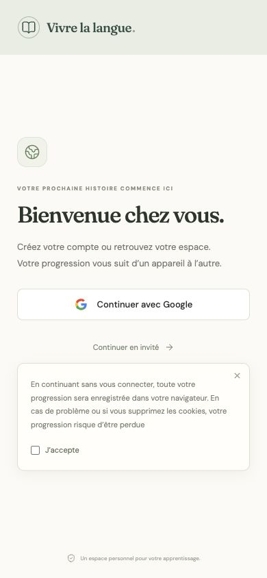

# Vérification de l’authentification — 3 novembre 2026

Version vérifiée localement sur `http://127.0.0.1:5173/`, avec le serveur Hono et sa base persistante `server/data/accounts.sqlite`. Aucun déploiement sur le VPS n’a été effectué.

## Parcours réels

- Connexion Google avec le client fourni : demande OAuth, choix du compte, consentement, échange de code côté serveur puis ouverture du profil.
- Premier profil : prénom, langue d’interface et langue apprise. Ouverture du tableau de bord et état « Compte sauvegardé ».
- SQLite : un profil terminé, un compte avec progression sauvegardée, `PRAGMA integrity_check = ok`.
- Déconnexion : retour à l’onboarding et aucune session active restante dans la base.
- Invité : avertissement demandé, case « J’accepte » sur la même ligne, ouverture de l’application après consentement.
- Affichage à 390 px : largeur de page égale au viewport, aucun débordement horizontal, case d’acceptation visible.
- Détection téléphone, recherche de pays et retour à la saisie e-mail également vérifiés avant le recentrage demandé sur Google + invité. Les envois e-mail/SMS restent désactivés.

Les deux URI de redirection suivantes ont été enregistrées puis relues dans Google Cloud avec l’autorisation explicite du propriétaire :

- `http://127.0.0.1:5173/api/auth/google/callback`
- `https://mathisbnl.fr/api/auth/google/callback`

Le client est nommé « Advaya language ». L’écran de consentement utilise le branding partagé du projet, « Quasar Indra ». Ce branding n’a pas été modifié pour préserver les autres clients du projet.

## Tests automatisés

- Compilation frontend TypeScript/Vite et serveur TypeScript.
- Sécurité HTTP, JSON, limites de taille, propriété des leçons, persistance et conservation des fichiers corrompus.
- Fournisseurs simulés : Google (PKCE, état, nonce, signature, audience), e-mail et SMS (tentatives, délai, expiration, usage unique).
- Sessions, révocation, origine des requêtes et isolation entre comptes/onglets.
- Treize scénarios de synchronisation : échecs réseau, révisions, conflits, écritures concurrentes, changement de compte pendant restauration, brouillons actifs préservés.
- Douze scénarios de publication : pas de faux succès, cache conservé lors d’un échec, changements de compte pendant les continuations asynchrones, interactions publiques séparées.
- Vérification Coach audio existante.

Un contrôle a reproduit une fermeture de connexion après un envoi surdimensionné. Les réponses HTTP 413 ferment désormais explicitement la connexion backend pour empêcher la réutilisation d’une connexion contenant encore le corps rejeté.

## Aperçus

## Limites

La version du VPS, la charge réelle, un second navigateur indépendant et la récupération sur un autre appareil n’ont pas été vérifiés avec un vrai compte. Les tests automatisés couvrent les deux comptes, les révisions et la persistance sur des données isolées. Docker Desktop n’étant pas démarré, l’image de production n’a pas été reconstruite pendant cette intervention. Aucun test matériel caméra/micro n’a été effectué. Les fichiers audio/vidéo restent locaux ; les clés API personnelles restent dans le cache de chaque compte/appareil.

Le secret Google est conservé uniquement dans `server/.env`, fichier ignoré par Git en mode 600. Il doit être renouvelé avant publication puisqu’il a été communiqué dans la conversation. Aucun secret ni jeton de session n’est inclus dans les captures ou cette documentation.
